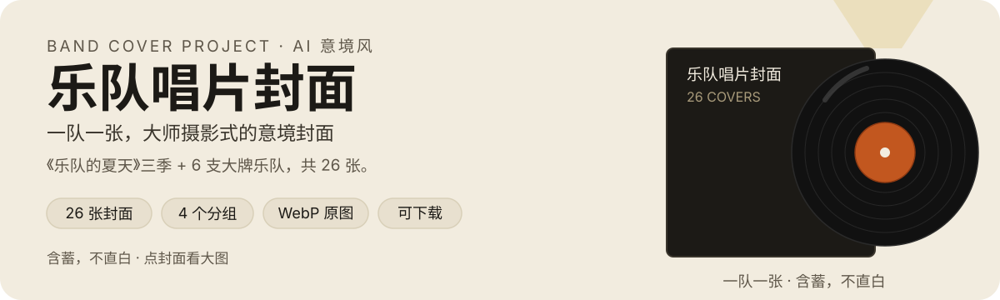
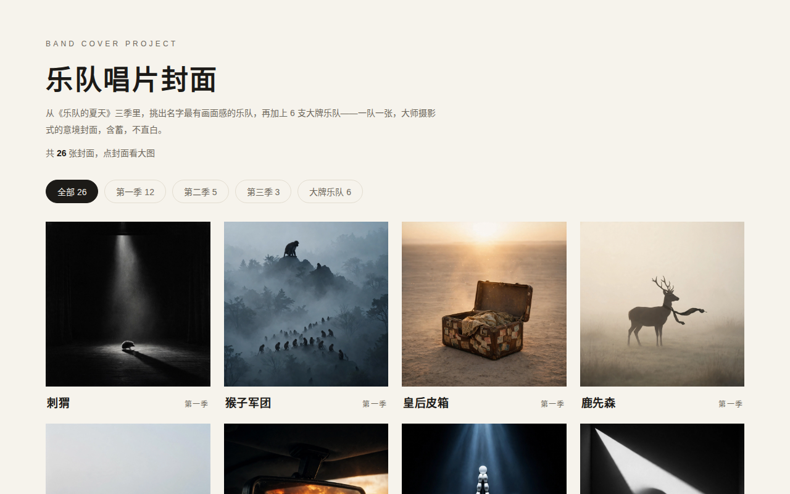
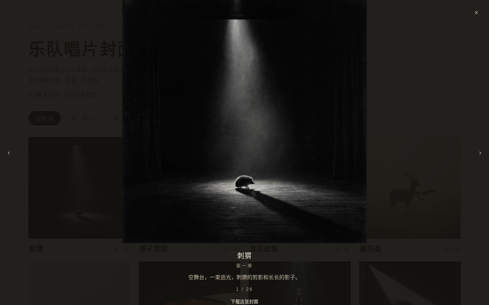

<p align="right"><a href="README.md">中文</a></p>

<p align="center">
  
</p>

<p align="center">
  <a href="https://holynova.github.io/band-album-covers/">▶ View Online</a>
  ·
  <a href="https://github.com/holynova/band-album-covers">GitHub Repository</a>
</p>

A gallery of 26 AI-generated album covers in a cinematic, understated style: bands with the most visual names from three seasons of *The Big Band* (乐队的夏天), plus 6 legendary bands — one cover per band. Each cover carries a one-line scene description; click to view full-size and download the original.

## Screenshots

<p align="center">
  
  <br>
  
</p>

## The Covers

| Group | Count | Bands |
| --- | --- | --- |
| 第一季 Season 1 | 12 | 刺猬 Hedgehog, 猴子军团 Monkey Legion, 皇后皮箱 Queen's Suitcase, 鹿先森 Mr. Deer, 海龟先生 Mr. Sea Turtle, 反光镜 Rearview Mirror, 盘尼西林 Penicillin, 面孔 Face, 葡萄不愤怒 Grapes Don't Get Angry, 熊猫眼 Panda Eyes, 宇宙人 Cosmic Man, MLK 麋鹿王国 MLK Reindeer Kingdom |
| 第二季 Season 2 | 5 | 霓虹花园 Neon Garden, 白皮书 White Paper, 岛屿心情 Island Mood, 旋转保龄 Spinning Bowling, 木马 Wooden Horse |
| 第三季 Season 3 | 3 | 橘子海 Orange Ocean, 八仙饭店 Eight Immortals Restaurant, 柏林护士 Berlin Nurse |
| 大牌乐队 Legendary bands | 6 | 黑豹 Black Panther, 唐朝 Tang Dynasty, 新裤子 New Pants, 二手玫瑰 Second Hand Rose, 五条人 Wu Tiao Ren, 达达乐队 Dada Band |

Every cover visualizes the band's name indirectly, never literally: Hedgehog is "an empty stage, a single spotlight, a hedgehog silhouette and a long shadow"; New Pants is "a rooftop clothesline, the wind lifting a jeans leg"; Wu Tiao Ren is "a tidal flat at low tide, five 人-shaped water trails reaching toward the sea".

## Features

- **Filter by season**: 全部 All / 第一季 Season 1 / 第二季 Season 2 / 第三季 Season 3 / 大牌乐队 Legendary bands — counts shown right on the buttons.
- **Lightbox**: click any cover for a full-screen view, with prev/next and arrow-key navigation.
- **Download the original**: save the current cover's WebP original from the lightbox.
- **One-line description**: every cover has a scene description, stored in `data.js` and matched to its image by name.

## Run Locally

A pure static site — just open `index.html`, or serve it statically:

```bash
python3 -m http.server 8000
# Open http://localhost:8000
```

To add a cover, append an entry to the `COVERS` array in `data.js` and drop a same-named `.webp` file into `covers/`.

## Tech

- Zero build, zero dependencies: a single `index.html` + `data.js` + `covers/`, no external requests.
- All 26 covers are WebP, about 5.8 MB in total.

```
index.html          Entry: cover wall / season filter / lightbox / download
data.js             26 cover entries: id / band name / season / one-line description
covers/             26 WebP cover originals (same names as the ids in data.js)
```
