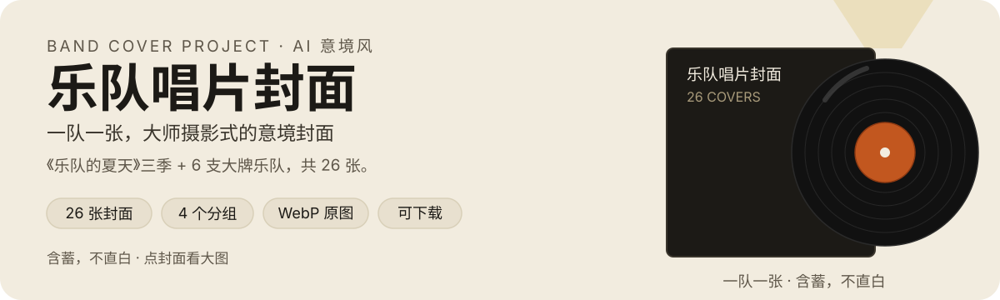
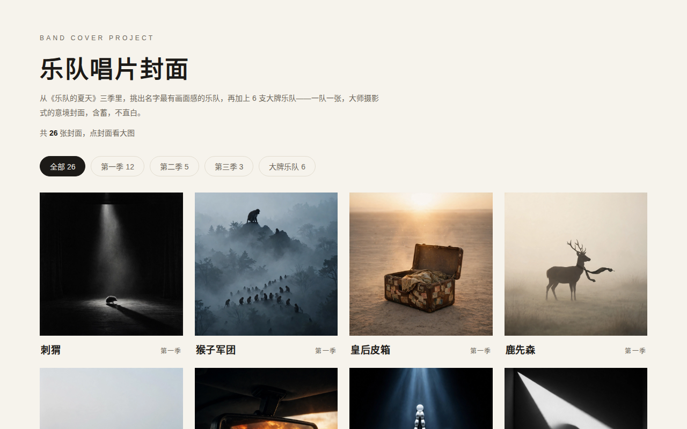
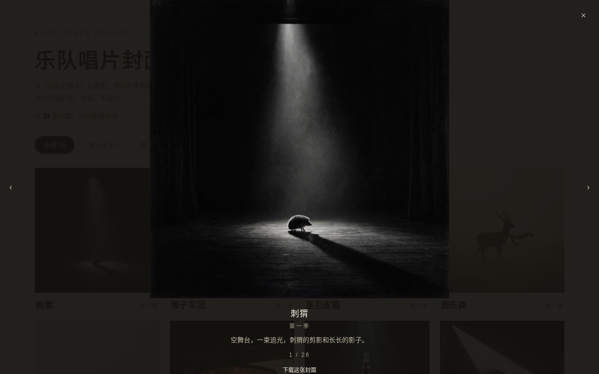

<p align="center">
  
</p>

<p align="center">
  <a href="https://holynova.github.io/band-album-covers/">▶ 在线看封面 View Online</a>
  ·
  <a href="https://github.com/holynova/band-album-covers">GitHub 仓库</a>
</p>

乐队唱片封面是 26 张 AI 意境风专辑封面的展示站：从《乐队的夏天》三季里挑出名字最有画面感的乐队，再加上 6 支大牌乐队，一队一张，大师摄影式的意境封面——含蓄，不直白。每张封面都有一句画面描述，点开看大图，还能下载原图。

A gallery of 26 AI-generated album covers in a cinematic, understated style: bands with the most visual names from three seasons of *The Big Band* （乐队的夏天）, plus 6 legendary bands — one cover per band. Each cover carries a one-line scene description; click to view full-size and download the original.

## 截图 / Screenshots

<p align="center">
  
  <br>
  
</p>

## 封面清单 / The Covers

| 分组 | 数量 | 乐队 |
| --- | --- | --- |
| 第一季 | 12 | 刺猬、猴子军团、皇后皮箱、鹿先森、海龟先生、反光镜、盘尼西林、面孔、葡萄不愤怒、熊猫眼、宇宙人、MLK 麋鹿王国 |
| 第二季 | 5 | 霓虹花园、白皮书、岛屿心情、旋转保龄、木马 |
| 第三季 | 3 | 橘子海、八仙饭店、柏林护士 |
| 大牌乐队 | 6 | 黑豹、唐朝、新裤子、二手玫瑰、五条人、达达乐队 |

每张封面的画面都紧扣队名做意境，不直给：刺猬是"空舞台，一束追光，刺猬的剪影和长长的影子"；新裤子是"天台晾衣绳，风吹起一条牛仔裤的裤腿"；五条人是"退潮滩涂，五条人字形水痕向海延伸"。

## 功能 / Features

- **按季筛选**：全部 / 第一季 / 第二季 / 第三季 / 大牌乐队，按钮上直接显示各组数量。
- **大图浏览**：点任意封面全屏查看，左右切换、键盘方向键也可翻页。
- **下载原图**：大图界面可下载当前封面的 WebP 原图。
- **一句描述**：每张封面配一句画面描述，写在 `data.js` 里，与图片同名对应。

## 本地运行 / Run Locally

纯静态站，直接打开 `index.html` 即可；或起一个静态服务器：

```bash
python3 -m http.server 8000
# 打开 http://localhost:8000
```

新增封面：在 `data.js` 的 `COVERS` 数组追加一条，并在 `covers/` 目录放入同名 `.webp` 文件。

## 技术 / Tech

- 零构建、零依赖：单个 `index.html` + `data.js` + `covers/`，无外部请求。
- 26 张封面均为 WebP 格式，共约 5.8 MB。

```
index.html          入口：封面墙 / 季筛选 / 大图浏览 / 下载
data.js             26 条封面数据：id / 队名 / 季 / 一句描述
covers/             26 张 WebP 封面原图（与 data.js 的 id 同名）
```

## English

**Band Album Covers** is a gallery of 26 AI-generated album covers in a cinematic, understated style — bands with the most visual names from three seasons of *The Big Band* （乐队的夏天）, plus 6 legendary bands, one cover per band.

- **The covers**: Season 1 (12 — Hedgehog, Monkey Legion, Queen's Suitcase, Mr. Deer, Mr. Sea Turtle, Rearview Mirror, Penicillin, Face, Grapes Don't Get Angry, Panda Eyes, Cosmic Man, MLK Reindeer Kingdom), Season 2 (5 — Neon Garden, White Paper, Island Mood, Spinning Bowling, Wooden Horse), Season 3 (3 — Orange Ocean, Eight Immortals Restaurant, Berlin Nurse), Legendary bands (6 — Black Panther, Tang Dynasty, New Pants, Second Hand Rose, Wu Tiao Ren, Dada Band).
- **Concept**: every cover visualizes the band's name indirectly — Hedgehog is an empty stage, a single spotlight, a hedgehog silhouette and a long shadow; New Pants is a pair of jeans flapping on a rooftop clothesline.
- **Features**: filter by season (counts on the buttons), full-screen lightbox with prev/next and keyboard navigation, one-line scene description per cover, download the original WebP.
- **Run it**: open `index.html` — no build step, no dependencies, no external requests. Add a cover by appending to `COVERS` in `data.js` and dropping a same-named `.webp` into `covers/`.
